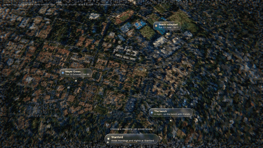

# Stanford: a memory world

<a href="media/polished.mp4"></a>

<p align="center"><a href="media/polished.mp4">▶ Watch the full-quality video (16 s)</a> · <a href="media/showcase.mp4">how it was made (15 s)</a></p>

Photos turned into places you can fly into, at Stanford: beach volleyball at sunset (23 June 2026, 19:11), the Main
Quad on a bike (12 October, 17:19), a picnic breakfast at Meyer Green (13 October, 08:36) and a night on a bench with
friends. The journey starts above California, descends onto each spot, lands in its photo, and hops across campus (a
few hundred metres up) to the next, then rises back out.

## Run it

```sh
python3 serve.py            # then open http://localhost:8771/dream-polished.html
```

`dream-polished.html` is the polished journey: it opens above the campus and goes to Meyer Green, the beach volleyball
courts and the bench at night (keys 1–3), each view crossfading into the next, the screen's edges dissolving into dots.
`dream.html` is the full journey with all four memories, from the map of California.

Any static web server works; `serve.py` only adds the right type for `.ply` files and disables caching.

| Input | What it does |
| --- | --- |
| scroll, ← → | move through the journey |
| space | drift on |
| drag | look around |
| W A S D | wander |
| 1–4 | fly to a memory (volleyball, Main Quad, Meyer Green, the bench) |
| M | back up to the map |

## How it was made

- **Place:** the photo's GPS point, USGS 3DEP elevation and USGS NAIP imagery around it (public domain), and the
  California map from the same sources.
- **Descent:** ten views from 450 m down to eye level, generated with World Labs Atlas from the photo and the aerial
  imagery around it (relit to the morning sun), then two views drifting around the picnic. Depth for every view was
  estimated with VGGT and scaled against the real terrain and the photo's own posed depth.
- **Depth holes:** Atlas leaves parts of a view without depth (up to half of it over sand or a dark terrace); they are
  filled from the depth around them, so they no longer show as far-off dots. Only holes at the top of a view looking
  out stay empty (the sky).
- **Volleyball, Main Quad, the bench:** built the same way (`october/tools/build_stanford_world.py`); the path shows a
  thinned set of each take's views so each one holds clearly. The Main Quad leaves by its own crane-out.
- **Beach volleyball:** a 48-view Atlas take (a descent from 451 m and an arc at eye level; one view left out where the
  setter jumps), using Atlas metric depth. One smooth depth correction per view makes all views agree with each other,
  the USGS ground and the photo's posed depth; the views are toned toward the photo's light and fused into one dot
  cloud (`volleyball-bubble.spz`). On the path the views hold for 8 frames and crossfade over 6 (at 24 fps), and the
  last one cuts into the real photo. Look or wander away at eye level and the fused cloud takes over.
- **Ground:** USGS points around the spot (`stanford-terrain`), fading into the California map.
- The pipeline that places a photo on its real terrain and plans the camera paths is
  [atlas-gps-context](https://github.com/hbeyer1/atlas-gps-context).

## Layout

- `dream.html`: the viewer (three.js and Spark, no build step).
- `journeys/stanford/`: `journey.json` (the camera path and its segments), `world.json` (where each point cloud sits),
  `frames/` (the views with their depth, 960 × 540, log depth in 16 bits), `clouds/lite/` (the ground and the map as `.ply` point clouds, the volleyball cloud as `.spz`),
  `alignment-volleyball.json` (per-view depth corrections).
- `vendor/`: three.js and Spark.

## Licence

The code is MIT licensed (see `LICENSE`). The photo and the generated views are © the author and not licensed for
reuse. USGS data is public domain. Vendored libraries keep their own licences: [three.js](https://github.com/mrdoob/three.js)
(MIT), [Spark](https://github.com/sparkjsdev/spark) (MIT).
